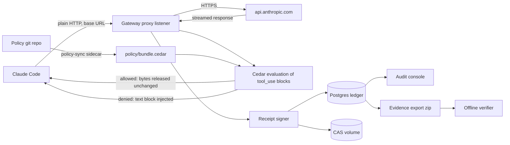

# Architecture

For someone deciding whether to run the local stack, and for the operator who wants to know what each part does.

## The path of a model call

## Client

Claude Code reads its gateway address from `ANTHROPIC_BASE_URL`. With it set, every model call goes there instead of to Anthropic, carrying the credential (an API key, or the bearer token of a claude.ai login). The gateway forwards the credential and stores none. The address is plain `http://`, so no certificate to install.

## Gateway listener

The gateway runs two listeners: the proxy port the base URL points at, and the audit-plane port that serves the console and its API. Both are cleartext HTTP, published on loopback in the local stack.

A request whose `Host` header names the gateway is sent to the default upstream, `api.anthropic.com`, with the outbound `Host` rewritten. Headers are forwarded as they arrived, except `Accept-Encoding`, removed so the upstream answers uncompressed and the stream can be read in flight.

## In-stream evaluation

An Anthropic Messages response streams as server-sent events. A tool call is a `tool_use` content block whose input arrives as JSON fragments and is complete only at the block's stop event.

The gateway buffers each `tool_use` block from start to stop event, assembles the input, and evaluates it against the Cedar bundle in force: the principal running the agent, the action `invoke_tool`, the tool name as the resource, and the input fields as context.

On allow, the buffered events are released byte-identical. On deny, the block is replaced by a text block naming the rule and the bundle hash, and the stop reason is adjusted so the client does not wait for a tool result. A denial is never an HTTP error, because the client retries errors. Non-streaming calls are read whole and treated the same way.

Claude Code makes several model calls per prompt (the agent turn, a session-title call, a side query); each is attested and its receipt records the kind.

## Receipts

Every model call produces one receipt in two parts. The envelope is what the gateway signs under its key (DSSE): run id, event kind, principal, timestamp, the SHA-256 of the Cedar bundle in force, the ledger position, and the SHA-256 of the body. The body is canonical JSON (RFC 8785): model and upstream host, wire format, the SHA-256 of the request and of the response bytes, token usage, call kind and client session id, and each extracted tool call with its decision. A denial is a receipt of its own in the same shape, naming the tool, the rule, and the call it came from.

The body is stored content-addressed under the hash the envelope carries, so the signature covers it by reference. Request and response bytes are stored under their hashes when `R5E_RETAIN_PAYLOADS` is `true`, which the compose file sets.

In the local stack the signing key is generated on first boot into a volume; the Postgres ledger holds the envelopes and Merkle roots, one epoch root per session under a global root; the content-addressed store is a second volume.

## Audit console

The console is served from the audit-plane port under `/admin`. Sign-in is a dev login the compose file enables; in a deployment it is an identity provider.

The console keeps a session's calls together and shows agent turns by default; session-title calls, side queries and the console's own reads are behind a call-kind filter. A denial is two red rows in that default view: the `tool_use_denied` receipt, and its parent model call, whose policy decision is deny. Each receipt opens to its envelope, its decisions and a local verification. A parser-drift panel and `/readyz` count the stream event types the parser did not recognise, so a client's format change is visible.

## Policy

The bundle is a Cedar file. With no git URL configured, the compose file mounts `policy/bundle.cedar` from the checkout; the shipped file forbids a few destructive shell commands on top of a baseline permit.

With a git URL configured, a sidecar pulls the repository on an interval and copies the bundle atomically into a volume the gateway reads; the gateway polls the file's modification time and reloads. A bundle that fails to load leaves the previous one in force and reports the failure on `/readyz` and in the console. Merge rights on that repository are the right to change what the gateway enforces.

## Evidence export and offline verification

An export is a zip: the envelope, the body, the retained request and response bytes, the signer's public key, the Merkle inclusion proofs, and the Cedar source of the bundle that decided, archived at activation so a later policy change does not alter it.

Verification runs on a machine with no access to the gateway and recomputes every hash the envelope and body carry against the bundled bytes and roots. Each step prints `MATCH`, `FAIL` or `SKIPPED`; the steps and exit codes are in [the verification walkthrough](auditor/verification_walkthrough.md).
